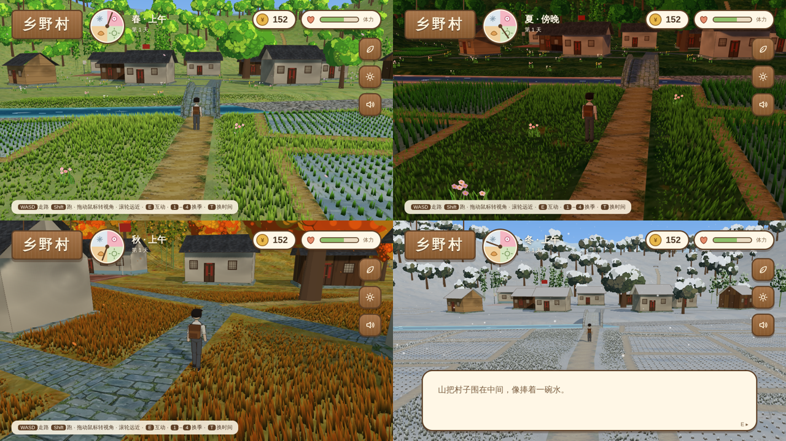

# 出走

一个小镇青年逃离重复的工作，一路打零工、看风景，在别人的人生里找到自己想要的生活。日系手绘风格的叙事卡牌游戏，计划上架 Steam。



## 目前进度

| 部分 | 状态 |
| --- | --- |
| 游戏形式 | 已定为叙事卡牌：Gemini 场景插画 + 动态立绘（见 `game/live-portrait-demo/`） |
| 第一章「乡野村」3D 试走 | 已暂停，保留作场景参考 |
| 界面 | C 方案「乡间木牌」已定稿并实现 |
| 序章「灰色小镇」 | 只有早期 2D 原型（`game/prototype-2d/`），卡牌版未开始 |
| 村民、零工、剧情 | 待定（村民设定是下一步） |
| 正式美术 | 进行中：Gemini 出乡野村 9 个地点的场景插画和人物立绘 |

唯一有效的策划文档是 claude.ai 上的「《出走》策划文档 v2」，所有新决定都写在那里；旧版「新手村剧情文案策划」已归档。界面设计稿：「出走 · 游戏界面方案」。

## 怎么运行

最快：直接用 Chrome 打开 `game/xiangye-3d/dist/index.html`（需要联网加载 3D 引擎）。

改了代码或素材之后重新生成：

```bash
pip install pillow numpy scipy
python3 game/xiangye-3d/tools/process_assets.py   # assets/source → assets/processed + assets.json
python3 game/xiangye-3d/tools/build.py            # → game/xiangye-3d/dist/index.html
python3 game/xiangye-3d/tools/build.py --offline  # 不联网也能跑的版本，给 Steam 打包用
```

## 操作

WASD 走路 · Shift 跑 · 拖动鼠标转视角 · 滚轮远近 · E 互动 · 1–4 换季 · T 换时间

## 目录

```
game/xiangye-3d/        第一章 3D 版（three.js r160）
  index.src.html        游戏源码（单文件：场景、角色、界面、着色器）
  tools/                素材处理和打包脚本
  vendor/               three.js（MIT）
  dist/                 打包输出
game/prototype-2d/      最早的 2D 横版原型（海边版剧情）
assets/source/          Gemini 生成的原图，按 characters / environment / textures 分
assets/processed/       抠图、裁切、压缩后进游戏的版本
docs/screenshots/       截图
```

## 素材说明

`assets/source/` 里的图片由 AI（Gemini）生成。上架 Steam 时需要在商店页的 AI 内容披露里说明。`npc_*_seaside_draft.png` 是按旧的海边设定画的，村民定稿后会替换。
